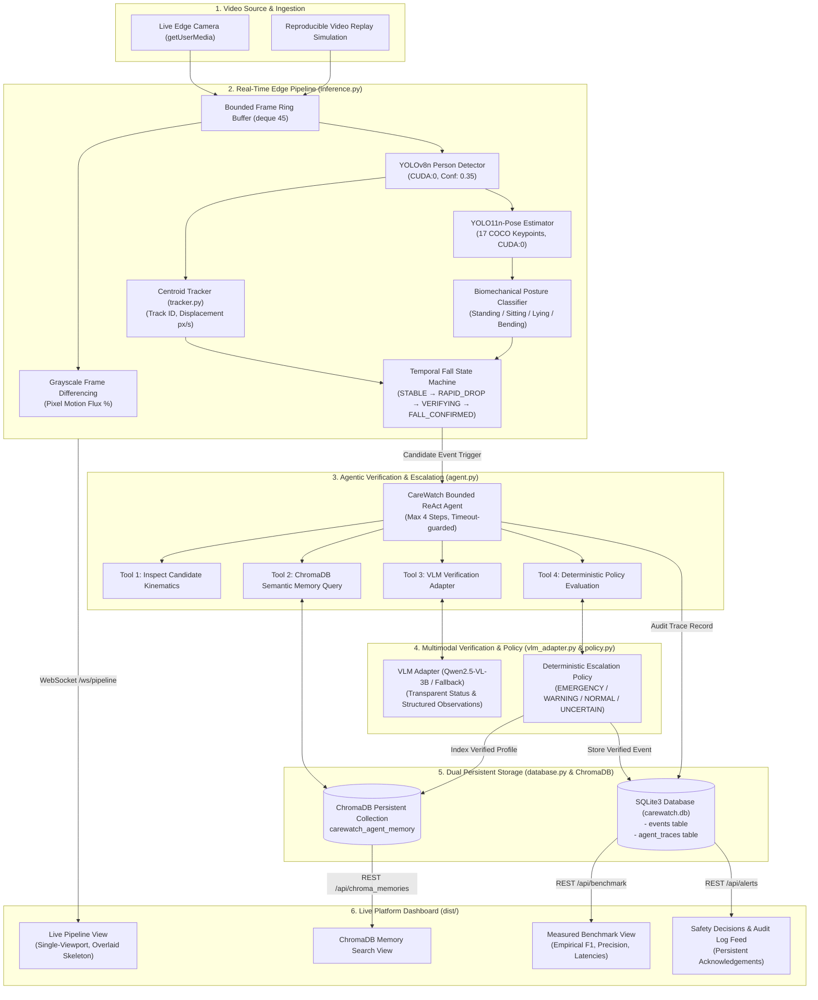

# CareWatch Edge AI Platform — System Architecture & Implementation Specification

## 1. System Overview
CareWatch is an enterprise-grade Edge-First Human Activity Recognition (HAR) and Fall-Detection platform designed for elderly monitoring, home healthcare, and assisted living facilities. It executes low-latency posture kinematics on local GPU edge hardware (NVIDIA RTX 3050 6GB CUDA) and coordinates a bounded, tool-using ReAct agent with persistent semantic memory (ChromaDB) and relational audit logging (SQLite).

---

## 2. End-to-End Logical Data Flow



---

## 3. Component Responsibilities & Boundaries

| Component | Technology | Primary Function | Failure Mode / Fallback |
|---|---|---|---|
| **Video Ingestion** | HTML5 Canvas / WebSockets | Captures 480×360 frames at ~25 FPS; supports live webcam and local video replay simulation | Degrades gracefully; stops timer on disconnect |
| **Person Detection & Motion** | YOLOv8n + Frame Diff | Differentiates camera-level pixel flux from resident presence | Scene marked `SCENE IDLE` when no boxes detected |
| **Track & Movement Estimation** | `CentroidTracker` | Tracks per-person IDs (`Track #1`), calculates centroid displacement (px/sec), and normalized displacement | Tracks tolerate up to 15 missed frames before termination |
| **Biomechanics & Posture** | YOLO11n-Pose | Computes torso vector angle (deg from vertical), aspect ratio, and joint heights | Flags `Partial View` when hips/knees occluded |
| **Temporal State Machine** | Multi-frame FSM | Demands prior upright state, rapid vertical velocity (>85 px/s), and sustained ground dwell (>1.5s) | Recovery resets candidate state to `RECOVERED` without false alert |
| **Tool-Using Agent** | `CareWatchAgent` | Executes bounded 4-step ReAct loop inspecting kinematics, memory, VLM, and policy | Bounded iterations prevent infinite reasoning loops |
| **VLM Adapter** | `VLMAdapter` | Schema-validated visual verification of candidate event frames | Transparent status reporting: `ONLINE` vs `WEIGHTS_INCOMPLETE` vs `RULE_BASED_FALLBACK` |
| **Escalation Policy** | `EscalationPolicy` | Deterministic escalation with cooldown deduplication (12s debounce) | Unverified events marked `UNCERTAIN / VERIFICATION REQUIRED` |
| **Persistent Storage** | SQLite (`carewatch.db`) + ChromaDB | Stores event audit history, acknowledgements, and high-dimensional semantic incident vectors | Resilient across backend restarts |

---

## 4. API Endpoints & Contracts

### REST Endpoints
- `GET /api/health`: Comprehensive system health across Video, YOLO, Pose, VLM, Agent, ChromaDB, SQLite, and Notification services.
- `GET /api/alerts`: Returns chronological list of all persisted events stored in SQLite.
- `POST /api/alerts/{id}/acknowledge`: Updates acknowledgement state in SQLite (persists across reloads).
- `GET /api/benchmark`: Serves empirical metrics computed from `benchmark_results.json`.
- `GET /api/agent/traces`: Returns transparent operational audit logs from the agent ReAct loop.
- `GET /api/chroma_memories`: Returns baseline and logged event vectors from persistent ChromaDB collection.
- `POST /api/query_memory`: Semantic vector search against historical incidents.

### WebSocket Contracts
- `WS /ws/pipeline`:
  - **Client sends**: JPEG base64 encoded frame.
  - **Server responds**:
    ```json
    {
      "timestamp": 124.5,
      "inference_ms": 38.2,
      "stage1_presence": {
        "person_present": true,
        "track_id": "Track #1",
        "movement_status": "Active Movement",
        "displacement_px_sec": 42.1,
        "motion_flux_pct": 2.8
      },
      "stage2_posture": {
        "category": "Sitting",
        "posture": "Sitting (Leaning Forward)",
        "torso_angle_deg": 34.2,
        "aspect_ratio": 0.72,
        "keypoints": [[x, y, conf], ...]
      },
      "stage3_event": {
        "state": "STABLE",
        "drop_velocity": 0.0,
        "ground_dwell_sec": 0.0,
        "fall_confirmed": false
      },
      "central_server": {
        "escalation_decision": "NORMAL / LOG",
        "decision_tone": "sage",
        "recommended_action": "Log baseline activity to ChromaDB & SQLite",
        "vlm_verification": {
          "verification_method": "RULE_BASED_FALLBACK",
          "is_true_fall": false,
          "confidence": 0.93
        }
      }
    }
    ```

---

## 5. False Alarm Suppression Architecture

The platform addresses common edge fall detection failure modes through three independent architectural gates:

1. **Controlled Sitting vs. Falling**:
   - Hip-knee vertical delta is evaluated; when knees remain bent and hips remain anchored at chair seat height, forward torso reach is classified as `Sitting (Leaning Forward)`.
   - Vertical drop velocity remains 0 px/s. Result: 0 false alarms.

2. **Intentional Lying Down / Sleeping vs. Falling**:
   - A resident lying in bed or resting on a sofa has horizontal posture (`Lying / Resting`), but lacks a prior upright transition with high downward acceleration.
   - State machine remains in `STABLE`. Result: 0 false alarms.

3. **Temporal Dwell Debounce & Recovery**:
   - If a resident trips but immediately stands up or sits up within the 1.5s verification window, the state transitions to `RECOVERED`. Result: Emergency alarm is suppressed.
